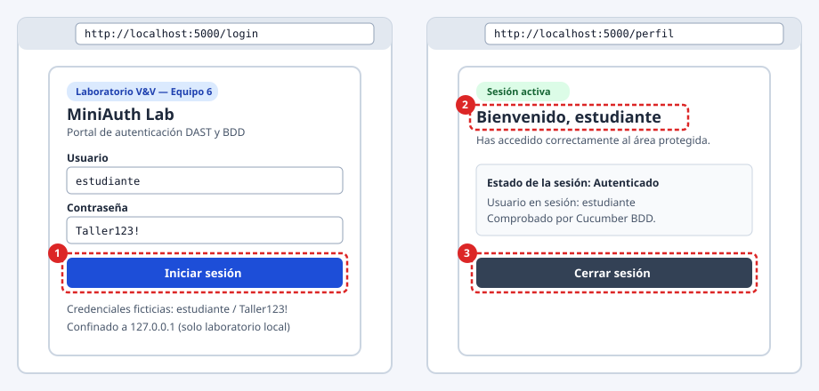
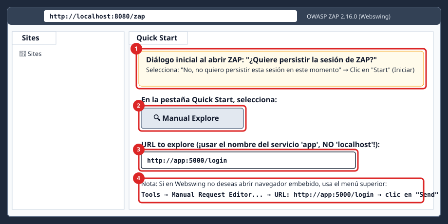
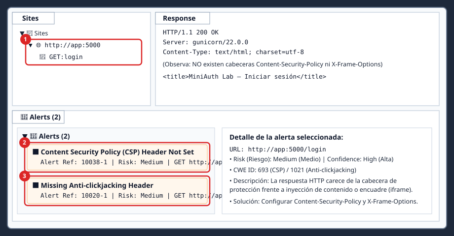

# MiniAuth Lab — Laboratorio Práctico de OWASP ZAP (DAST) y Cucumber (BDD)

**Verificación y Validación de Software — Equipo 6**  
**Duración estimada en clase:** 15 a 20 minutos (con imágenes descargadas previamente).  
**Entregables:** **Ninguno.** Este laboratorio es 100 % práctico y formativo; no debes entregar capturas, reportes ni documentos.

---

## Índice

1. [¿Qué vas a aprender?](#1-qué-vas-a-aprender)
2. [Advertencia de seguridad](#2-advertencia-de-seguridad)
3. [Antes del taller (Preparación previa)](#3-antes-del-taller-preparación-previa)
4. [Presupuesto de tiempo del laboratorio (20 minutos)](#4-presupuesto-de-tiempo-del-laboratorio-20-minutos)
5. [Paso 1: Clonar el repositorio (1 min)](#5-paso-1-clonar-el-repositorio-1-min)
6. [Paso 2: Iniciar los contenedores del laboratorio (2 min)](#6-paso-2-iniciar-los-contenedores-del-laboratorio-2-min)
7. [Paso 3: Explorar MiniAuth Lab en tu navegador (2 min)](#7-paso-3-explorar-miniauth-lab-en-tu-navegador-2-min)
8. [Paso 4: Análisis pasivo de seguridad con OWASP ZAP (6 min)](#8-paso-4-análisis-pasivo-de-seguridad-con-owasp-zap-6-min)
9. [Paso 5: Pruebas de comportamiento (BDD) con Cucumber (7 min)](#9-paso-5-pruebas-de-comportamiento-bdd-con-cucumber-7-min)
10. [Paso 6: Cierre y comparación DAST vs BDD (2 min)](#10-paso-6-cierre-y-comparación-dast-vs-bdd-2-min)
11. [Apagado del laboratorio](#11-apagado-del-laboratorio)
12. [Solución de problemas frecuentes (Troubleshooting)](#12-solución-de-problemas-frecuentes-troubleshooting)

---

## 1. ¿Qué vas a aprender?

Con **OWASP ZAP (DAST)** descubrirás qué configuraciones de seguridad están ausentes en las respuestas HTTP reales de una aplicación web en funcionamiento sin necesidad de leer su código fuente. Con **Cucumber (BDD)** comprobarás de manera automatizada si esa misma aplicación cumple el comportamiento funcional esperado escrito en lenguaje natural (**Gherkin en español**).

---

## 2. Advertencia de seguridad

> [!WARNING]
> **MiniAuth Lab es una aplicación deliberadamente insegura creada con fines exclusivamente académicos.**
> - Todos los puertos están enlazados únicamente a tu interfaz local (`127.0.0.1`).
> - **Nunca** despliegues esta aplicación en un servidor público, nube o red abierta.
> - **Nunca** utilices OWASP ZAP contra sitios o dominios externos sin autorización expresa: en esta práctica solo analizarás el servicio interno `http://app:5000`.

---

## 3. Antes del taller (Preparación previa)

No necesitas instalar Python, Java, Maven ni OWASP ZAP en tu computadora: todo corre dentro de contenedores Docker.

### 3.1 Requisitos mínimos de tu equipo

- **Memoria RAM libre sugerida:** al menos **4 GB** disponibles para Docker (OWASP ZAP con Webswing utiliza entre 1.5 GB y 2 GB de RAM).
- **Espacio en disco libre:** al menos **5 GB** para almacenar las imágenes de los contenedores.
- **Software requerido:** **Git** y **Docker con Docker Compose**.

Si aún no los tienes instalados antes de la sesión, utiliza únicamente la documentación oficial para tu sistema operativo:
- **Git:** https://git-scm.com/downloads
- **Windows 10/11 (Docker Desktop con backend WSL 2 activado):** https://docs.docker.com/desktop/setup/install/windows-install/
- **macOS Intel o Apple Silicon (Docker Desktop):** https://docs.docker.com/desktop/setup/install/mac-install/
- **Linux (Docker Engine + Docker Compose plugin):** https://docs.docker.com/engine/install/ y https://docs.docker.com/compose/install/linux/

### 3.2 Verificar que Git y Docker están encendidos

Abre tu terminal y ejecuta estos tres comandos uno por uno:

```bash
git --version
docker compose version
docker info
```

**Qué debes observar:**
- `git --version` muestra una versión (por ejemplo `git version 2.x.x`).
- `docker compose version` muestra `Docker Compose version v2.x.x`.
- `docker info` imprime información de `Server: Docker Engine` sin mensajes de error. Si muestra un error de conexión al daemon, **abre primero la aplicación Docker Desktop** y espera unos 30 segundos a que su estado indique *Engine running*.

### 3.3 Descarga anticipada de imágenes (recomendado antes de iniciar la clase)

La imagen oficial de OWASP ZAP pesa alrededor de 1.5 GB. Para garantizar que el laboratorio dure menos de 20 minutos en clase, descarga las imágenes de antemano tras clonar el repositorio (Paso 1) ejecutando:

```bash
docker compose pull
```

---

## 4. Presupuesto de tiempo del laboratorio (20 minutos)

| Etapa | Actividad | Tiempo máximo objetivo |
|---|---|---:|
| **Pasos 1 y 2** | Clonar (si no está clonado) y levantar contenedores con imágenes ya descargadas | 3 min |
| **Paso 3** | Visitar MiniAuth Lab e iniciar/cerrar sesión | 2 min |
| **Paso 4** | OWASP ZAP: explorar `http://app:5000/login` y analizar dos alertas pasivas | 6 min |
| **Paso 5** | Cucumber BDD: ejecutar suite `PASS` → fallo controlado `FAIL` → suite `PASS` | 7 min |
| **Paso 6** | Cierre comparativo y apagado del entorno | 2 min |
| **TOTAL** | **Experiencia completa en clase** | **20 min** |

---

## 5. Paso 1: Clonar el repositorio (1 min)

1. Abre la terminal de tu sistema operativo:
   - **Windows:** presiona la tecla `Windows`, escribe `PowerShell` y haz clic en **Windows PowerShell**.
   - **macOS:** presiona `Cmd + Espacio`, escribe `Terminal` y presiona `Enter`.
   - **Linux:** abre tu aplicación **Terminal** (`Ctrl + Alt + T`).
2. Ejecuta los siguientes comandos para descargar el proyecto y entrar en su carpeta:

```bash
git clone https://github.com/marriott55/miniauth-lab.git
cd miniauth-lab
```

3. Comprueba que estás dentro del directorio correcto listando sus archivos:

```bash
ls
```

**Qué debes observar:** en la salida deben aparecer los archivos `README.md`, `compose.yaml`, `compose.dev.yaml` y las carpetas `app`, `cucumber` y `docs`.

---

## 6. Paso 2: Iniciar los contenedores del laboratorio (2 min)

1. Si no descargaste las imágenes antes de la clase, descárgalas ahora:

```bash
docker compose pull
```

> **Nota alternativa (si no hay acceso a GHCR o prefieres compilar localmente):** puedes construir e iniciar las imágenes directamente desde el código fuente incluido ejecutando `docker compose -f compose.yaml -f compose.dev.yaml up -d --build`.

2. Levanta en segundo plano la aplicación web (`app`) y OWASP ZAP (`zap`):

```bash
docker compose up -d
```

3. Comprueba el estado de los contenedores:

```bash
docker compose ps
```

**Qué debes observar:**
- Dos contenedores en ejecución (`Up`):
  - `miniauth-app` con estado `Up ... (healthy)` y puerto `127.0.0.1:5000->5000/tcp`.
  - `miniauth-zap` con estado `Up ...` y puerto `127.0.0.1:8080->8080/tcp`.
- El servicio `cucumber` **no** aparece en `docker compose ps` porque solo se ejecuta bajo demanda en el Paso 5.

---

## 7. Paso 3: Explorar MiniAuth Lab en tu navegador (2 min)



1. Abre el navegador de tu computadora (Chrome, Firefox, Edge o Safari) y entra en:
   ```text
   http://localhost:5000/login
   ```
2. **Qué debes observar:** una tarjeta centrada con el título **MiniAuth Lab**, campos **Usuario** y **Contraseña**, y el botón azul **Iniciar sesión**.
3. Introduce las credenciales ficticias de demostración (creadas exclusivamente para este laboratorio):
   - **Usuario:** `estudiante`
   - **Contraseña:** `Taller123!`
4. Haz clic en **Iniciar sesión**.
5. **Qué debes observar:** la URL cambia a `http://localhost:5000/perfil` y aparece el encabezado **`Bienvenido, estudiante`** con la etiqueta verde **`Sesión activa`**.
6. Haz clic en el botón **Cerrar sesión**.
7. **Qué debes observar:** vuelves al formulario en `http://localhost:5000/login`. Si intentas escribir manualmente `http://localhost:5000/perfil` en la barra de direcciones sin haber iniciado sesión, el sistema te redirigirá de nuevo a `/login`.

---

## 8. Paso 4: Análisis pasivo de seguridad con OWASP ZAP (6 min)

En este paso usarás **OWASP ZAP 2.16.0** directamente desde tu navegador gracias a **Webswing**, sin instalar nada ni configurar certificados ni proxies en tu sistema.

> [!IMPORTANT]
> **Concepto clave de redes en Docker (`localhost` vs `app`):**
> - Cuando usas el navegador de tu computadora, entras a `http://localhost:5000`.
> - Sin embargo, **OWASP ZAP vive dentro de su propio contenedor Docker** en la red interna `miniauth_net`. Dentro de esa red, la aplicación web se llama **`app`**.
> - Por lo tanto, **dentro de la ventana de OWASP ZAP siempre debes escribir `http://app:5000/login`** (nunca `localhost:5000`).

### 8.1 Abrir la interfaz de OWASP ZAP en Webswing

1. En una nueva pestaña del navegador de tu computadora, abre exactamente esta dirección (incluyendo `/zap` al final):
   ```text
   http://localhost:8080/zap
   ```
2. **Condición de espera:** la primera vez que se abre, Webswing inicia la interfaz gráfica de ZAP; esto tarda entre **15 y 40 segundos**. Verás una barra de carga y luego aparecerá la ventana de escritorio de OWASP ZAP dentro de tu navegador.
3. En el cuadro de diálogo inicial titulado **"Do you want to persist the ZAP session?"** (*¿Quiere persistir la sesión de ZAP?*):
   - Selecciona la tercera opción: **`No, I do not want to persist this session at this moment in time`** (*No, no quiero persistir esta sesión en este momento*).
   - Haz clic en el botón **`Start`** (*Iniciar*).
   - *(Si aparece una ventana informativa de "Manage Add-ons" o actualizaciones, ciérrala haciendo clic en la `X` o en `Close`).*

### 8.2 Generar tráfico hacia `http://app:5000/login` desde ZAP



Para que el analizador pasivo de ZAP observe la respuesta HTTP de nuestra aplicación sin depender de un navegador externo, enviaremos una petición directa desde ZAP:

1. En la barra de menú superior de la ventana de OWASP ZAP, haz clic en **`Tools`** (*Herramientas*) → **`Manual Request Editor...`** (*Editor de peticiones manuales...*).
   - *(Alternativa equivalente desde la pestaña central **Quick Start**: haz clic en **Manual Explore**, escribe `http://app:5000/login` en **URL to explore** y pulsa **Launch Browser**).*
2. En la ventana **Manual Request Editor** que se abre:
   - Asegúrate de que la línea superior de la petición indique `GET` y cambia la URL del campo o de la primera línea a:
     ```text
     http://app:5000/login
     ```
   - Haz clic en el botón **`Send`** (*Enviar*) en la esquina superior derecha de esa ventana.
3. **Qué debes observar en la pestaña `Response` de esa ventana:** el servidor responde `HTTP/1.1 200 OK` y debajo aparece el código HTML con `<title>MiniAuth Lab — Iniciar sesión</title>`.
4. Cierra la ventana **Manual Request Editor** haciendo clic en su `X` superior derecha.

### 8.3 Inspeccionar el árbol `Sites` y las dos alertas pasivas en `Alerts`



1. Mira el panel superior izquierdo en la pestaña **`Sites`** (*Sitios*):
   - Despliega la carpeta `Sites` → verás el nodo **`http://app:5000`** y dentro de él **`GET:login`**.
2. Espera de **2 a 5 segundos** para que el escáner pasivo termine de analizar la respuesta.
3. Mira el panel inferior y haz clic en la pestaña **`Alerts`** (*Alertas*, identificada con un icono de bandera):
   - Despliega el árbol de alertas haciendo clic en la flecha junto a las banderas naranjas (`Risk: Medium`).
4. **Debes observar y abrir estas dos alertas pasivas verificadas:**

| # | Nombre exacto de la alerta en ZAP | ID / Referencia | Nivel de Riesgo | Qué significa y cómo se corrige |
|---|---|---|---|---|
| **1** | **`Content Security Policy (CSP) Header Not Set`** | `10038-1` | **Medium** (Naranja) | **Causa:** La respuesta HTML de `http://app:5000/login` no incluye la cabecera `Content-Security-Policy`.<br>**Impacto:** Mayor exposición ante inyección de scripts (XSS) o carga de recursos no autorizados.<br>**Recomendación de ZAP:** Configurar la cabecera HTTP `Content-Security-Policy` restringiendo los orígenes permitidos (`default-src 'self'`). |
| **2** | **`Missing Anti-clickjacking Header`** | `10020-1` | **Medium** (Naranja) | **Causa:** La respuesta HTML no incluye la cabecera `X-Frame-Options` ni la directiva `frame-ancestors` en CSP.<br>**Impacto:** Un sitio malicioso podría incrustar la página de login dentro de un `<iframe>` invisible para engañar al usuario (*Clickjacking*).<br>**Recomendación de ZAP:** Enviar `X-Frame-Options: DENY` (o `SAMEORIGIN`) y `Content-Security-Policy: frame-ancestors 'none'`. |

5. Haz clic sobre cada una de las dos alertas en el panel izquierdo de `Alerts` y luego sobre la URL **`http://app:5000/login`** que aparece debajo: a la derecha verás los campos **`URL`**, **`Risk`**, **`Confidence`**, **`Description`** y **`Solution`** generados por ZAP al analizar la respuesta real.

> **Reflexión DAST:** Nota que estas dos alertas indican **configuraciones de defensa ausentes** detectadas de forma pasiva al observar el tráfico HTTP; no significan por sí solas que el servidor haya sido vulnerado o explotado.

---

## 9. Paso 5: Pruebas de comportamiento (BDD) con Cucumber (7 min)

Ahora verificarás si **MiniAuth Lab** cumple su especificación funcional utilizando **Cucumber-JVM** y **Gherkin en español**.

### 9.1 ¿Cómo están estructuradas las pruebas BDD?

Las pruebas de comportamiento conectan tres elementos:
- **Archivo `.feature`** (`cucumber/src/test/resources/features/autenticacion.feature`): describe los escenarios en lenguaje natural usando las palabras clave en español **`Característica`**, **`Escenario`**, **`Dado`** (*Given*), **`Cuando`** (*When*), **`Entonces`** (*Then*) e **`Y`** (*And*).
- **Step Definitions** (`cucumber/src/test/java/io/miniauth/bdd/StepDefinitions.java`): métodos en Java anotados con `@Dado`, `@Cuando` y `@Entonces` que traducen cada oración de Gherkin en peticiones HTTP reales contra `http://app:5000`.
- **Cliente HTTP real** (`HttpTestClient.java`): envía el formulario `POST /login`, gestiona las cookies de sesión y comprueba el código de respuesta y el texto HTML recibido.

### 9.2 Ejecutar la suite normal (Resultado esperado: `PASS`)

Regresa a tu terminal (ubicada en la carpeta del proyecto) y ejecuta:

```bash
docker compose run --rm cucumber
```

*(Nota: si levantaste el entorno en modo de construcción local con `compose.dev.yaml`, usa `docker compose -f compose.yaml -f compose.dev.yaml run --rm cucumber`).*

**Qué debes observar en la consola (tarda de 3 a 6 segundos):**

```text
Característica: Autenticación de usuarios
  Para proteger el acceso al perfil
  Como usuario de MiniAuth
  Quiero iniciar sesión con mis credenciales

  @normal
  Escenario: Inicio de sesión correcto
    Dado que existe el usuario de demostración
    Cuando inicia sesión con usuario "estudiante" y contraseña "Taller123!"
    Entonces debe acceder a su perfil
    Y debe ver el mensaje "Bienvenido, estudiante"

  @normal
  Escenario: Rechazo de contraseña incorrecta
    Dado que existe el usuario de demostración
    Cuando inicia sesión con usuario "estudiante" y contraseña "incorrecta"
    Entonces el acceso debe ser rechazado
    Y debe ver el mensaje "Credenciales incorrectas"

2 Scenarios (2 passed)
8 Steps (8 passed)
...
[INFO] Tests run: 2, Failures: 0, Errors: 0, Skipped: 0
[INFO] BUILD SUCCESS
```

Ambos escenarios pasan (`BUILD SUCCESS`): el sistema permite entrar al usuario con credenciales válidas y rechaza la contraseña incorrecta con el mensaje esperado.

### 9.3 Ejecutar el fallo intencional controlado (Resultado esperado: `FAIL`)

¿Qué ocurre cuando un escenario Gherkin exige un comportamiento que **contradice** lo que hace el sistema? El archivo `cucumber/src/test/resources/features/autenticacion_fallo.feature` contiene un escenario etiquetado con `@fallo-controlado` que inicia sesión con credenciales **válidas** (`estudiante` / `Taller123!`), pero exige ver el mensaje **`"Acceso denegado"`**.

Ejecútalo con este comando:

```bash
docker compose run --rm -e CUCUMBER_FILTER_TAGS=@fallo-controlado cucumber
```

**Qué debes observar en la consola:**

```text
@fallo-controlado
Escenario: Mensaje esperado equivocado
  Dado que existe el usuario de demostración
  Cuando inicia sesión con usuario "estudiante" y contraseña "Taller123!"
  Entonces debe ver el mensaje "Acceso denegado"
      org.opentest4j.AssertionFailedError: Fallo de aserción BDD: Se esperaba encontrar el mensaje ["Acceso denegado"] en la respuesta HTML (ruta /perfil, HTTP 200), pero no estuvo presente. ==> expected: <true> but was: <false>

1 Scenarios (1 failed)
3 Steps (1 failed, 2 passed)
...
[ERROR] Tests run: 1, Failures: 1, Errors: 0, Skipped: 0
[INFO] BUILD FAILURE
```

> **¿Por qué este `BUILD FAILURE` es el resultado correcto en este paso?**  
> Porque demuestra que la prueba de Cucumber **realmente inspecciona la respuesta de la aplicación** y detecta de inmediato cuando la expectativa escrita en el escenario (`"Acceso denegado"`) no coincide con la respuesta real del sistema (`"Bienvenido, estudiante"` en `/perfil`).

### 9.4 Volver a ejecutar la suite normal (`PASS`)

Para comprobar que los escenarios están aislados entre sí y que el estado del laboratorio sigue intacto sin necesidad de editar ni deshacer cambios en ningún archivo, vuelve a ejecutar:

```bash
docker compose run --rm cucumber
```

**Qué debes observar:** nuevamente `2 Scenarios (2 passed)` y `[INFO] BUILD SUCCESS`.

---

## 10. Paso 6: Cierre y comparación DAST vs BDD (2 min)

Observa cómo ambas herramientas evaluaron **la misma aplicación (`MiniAuth Lab`)**, pero respondieron preguntas distintas y complementarias:

| Herramienta | Tipo de Verificación | ¿Qué pregunta responde? | Resultado observado en MiniAuth Lab |
|---|---|---|---|
| **OWASP ZAP** | **DAST** (*Seguridad dinámica*) | *¿Qué debilidades o configuraciones inseguras expone la aplicación web en sus respuestas HTTP en tiempo de ejecución?* | **2 alertas pasivas (`Medium`):** ausencia de cabecera `Content-Security-Policy` (`10038-1`) y ausencia de cabecera anti-clickjacking `X-Frame-Options` (`10020-1`) en `/login`. |
| **Cucumber-JVM** | **BDD** (*Comportamiento funcional*) | *¿El sistema cumple los criterios de aceptación funcionales acordados en los escenarios Gherkin?* | **2 escenarios `PASS`:** login válido accede a `/perfil` (`Bienvenido, estudiante`) y contraseña errónea es rechazada (`Credenciales incorrectas`). |

**Conclusión clave:** Una aplicación puede pasar el **100 % de sus pruebas funcionales en Cucumber** y aun así presentar **deficiencias de seguridad detectables por OWASP ZAP** (y viceversa). Por ello, en Verificación y Validación de Software ambos tipos de pruebas son complementarios.

---

## 11. Apagado del laboratorio

Cuando hayas terminado la práctica, detén y elimina los contenedores ejecutando en tu terminal:

```bash
docker compose down
```

**Qué debes observar:** Docker detiene y elimina `miniauth-zap`, `miniauth-app` y la red `miniauth_net`.

> **Nota opcional (solo si deseas liberar espacio en disco tras finalizar el curso):**  
> No ejecutes el siguiente comando si vas a volver a usar el laboratorio en clase, ya que borrará las imágenes descargadas:
> ```bash
> docker compose down --rmi all
> ```

---

## 12. Solución de problemas frecuentes (Troubleshooting)

Si encuentras algún inconveniente durante la práctica, ubica el síntoma en la siguiente tabla y ejecuta el comando indicado:

### 12.1 Docker daemon apagado
- **Síntoma aproximado:** `Cannot connect to the Docker daemon...` o `open //./pipe/dockerDesktopLinuxEngine: The system cannot find the file specified.`
- **Causa:** Docker Desktop (Windows/macOS) o el servicio `docker` (Linux) no está iniciado.
- **Comandos exactos:** Abre la aplicación **Docker Desktop**, espera ~30 segundos a que indique *Engine running* (en Linux ejecuta `sudo systemctl start docker`) y verifica con:
  ```bash
  docker info
  ```
- **Resultado esperado:** Se muestra la sección `Server: Docker Engine` sin errores.

### 12.2 Puerto ocupado (`port is already allocated` / `address already in use`)
- **Síntoma aproximado:** `Error response from daemon: Ports are not available: exposing port TCP 127.0.0.1:5000 ... bind: address already in use`
- **Causa:** Otro contenedor o aplicación local (ej. *AirPlay Receiver* en macOS) está ocupando el puerto `5000` o `8080`.
- **Comandos exactos:**
  ```bash
  docker compose down
  docker ps
  ```
  *(En macOS, si el puerto `5000` sigue ocupado sin contenedores activos, desactiva **Receptor AirPlay** en Configuración del Sistema → General → AirDrop y Handoff).* Luego vuelve a iniciar:
  ```bash
  docker compose up -d
  ```
- **Resultado esperado:** `miniauth-app` y `miniauth-zap` arrancan en estado `Up`.

### 12.3 Imagen no descargada o red lenta en el aula
- **Síntoma aproximado:** `manifest unknown`, `pull access denied` o descarga detenida.
- **Causa:** Las imágenes preconstruidas no se descargaron antes de clase o hay bloqueo hacia `ghcr.io`.
- **Comandos exactos (construcción local desde los Dockerfiles del proyecto):**
  ```bash
  docker compose -f compose.yaml -f compose.dev.yaml up -d --build
  ```
- **Resultado esperado:** Docker construye localmente `miniauth-app:local` y `miniauth-cucumber:local` y levanta el entorno.

### 12.4 Acceso denegado al daemon de Docker en Linux (`permission denied`)
- **Síntoma aproximado:** `permission denied while trying to connect to the Docker daemon socket at unix:///var/run/docker.sock`
- **Causa:** Tu usuario de Linux no pertenece al grupo `docker`.
- **Comandos exactos:**
  ```bash
  sudo usermod -aG docker $USER
  newgrp docker
  docker compose ps
  ```
- **Resultado esperado:** `docker compose ps` funciona sin requerir `sudo`.

### 12.5 OWASP ZAP aún inicializando en `http://localhost:8080/zap`
- **Síntoma aproximado:** La página muestra *"Starting application..."*, pantalla gris o no responde inmediatamente tras `docker compose up -d`.
- **Causa:** ZAP inicia una interfaz gráfica de escritorio sobre Java y Webswing que tarda de 15 a 40 segundos en estar lista.
- **Comandos exactos:**
  ```bash
  docker compose logs --tail=20 zap
  ```
  Espera 15 segundos y recarga en tu navegador `http://localhost:8080/zap`.
- **Resultado esperado:** Aparece la ventana de bienvenida de OWASP ZAP.

### 12.6 OWASP ZAP muestra `0` alertas en el panel `Alerts`
- **Síntoma aproximado:** Visitaste `http://localhost:5000/login` en el navegador de tu computadora, pero en ZAP la pestaña `Alerts` sigue vacía (`0`).
- **Causa:** El navegador de tu computadora se conecta directamente al puerto `5000` sin pasar por ZAP.
- **Pasos exactos:** Dentro de la ventana de OWASP ZAP (`http://localhost:8080/zap`), abre **`Tools` → `Manual Request Editor...`**, escribe `http://app:5000/login`, haz clic en **`Send`** y espera 3 segundos.
- **Resultado esperado:** Aparece `http://app:5000` en `Sites` y las 2 alertas de riesgo medio (`10038-1` y `10020-1`) en `Alerts`.

### 12.7 Error al escribir `http://localhost:5000` dentro de OWASP ZAP
- **Síntoma aproximado:** ZAP devuelve un error `Connection refused` al intentar abrir `http://localhost:5000/login`.
- **Causa:** Dentro del contenedor de ZAP, `localhost` es el propio contenedor de ZAP, no el contenedor de la aplicación Flask.
- **Solución exacta:** Escribe siempre el nombre del servicio en la red de Docker Compose:
  ```text
  http://app:5000/login
  ```
- **Resultado esperado:** La pestaña `Response` de ZAP muestra `HTTP/1.1 200 OK` con el HTML de `MiniAuth Lab`.

### 12.8 El contenedor `cucumber` no logra conectarse a `app`
- **Síntoma aproximado:** `No fue posible conectar con MiniAuth en http://app:5000/health.`
- **Causa:** El contenedor `app` no está encendido o no está `healthy`.
- **Comandos exactos:**
  ```bash
  docker compose up -d app
  docker compose ps
  docker compose run --rm cucumber
  ```
- **Resultado esperado:** `miniauth-app` muestra `(healthy)` y `cucumber` ejecuta los 2 escenarios con `BUILD SUCCESS`.

### 12.9 Error `UndefinedStepException` (`undefined step`) en Cucumber
- **Síntoma aproximado:** `io.cucumber.junit.platform.engine.UndefinedStepException: The step '...' is undefined.`
- **Causa:** Se editó por accidente alguna frase en `autenticacion.feature`.
- **Comandos exactos:**
  ```bash
  git checkout -- cucumber/src/test/resources/features/
  docker compose run --rm cucumber
  ```
- **Resultado esperado:** Los pasos coinciden nuevamente con `StepDefinitions.java` y la suite pasa.

### 12.10 Error de Maven en modo offline (`Cannot access central in offline mode`)
- **Síntoma aproximado:** `Cannot access central (https://repo.maven.apache.org/maven2) in offline mode`
- **Causa:** La imagen local de `cucumber` fue modificada sin completar el precargado de dependencias.
- **Comandos exactos:**
  ```bash
  docker compose -f compose.yaml -f compose.dev.yaml build --no-cache cucumber
  ```
- **Resultado esperado:** La imagen descarga y almacena todos los plugins de Maven durante el build y permite ejecutar `cucumber` sin internet.

### 12.11 El comando de fallo controlado falla por causa distinta a la aserción
- **Síntoma aproximado:** Al ejecutar el comando con `-e CUCUMBER_FILTER_TAGS` aparece un error de sintaxis de consola o no se selecciona `@fallo-controlado`.
- **Causa:** Comillas tipográficas o incompatibles copiadas en la terminal.
- **Comando exacto sin comillas conflictivas:**
  ```bash
  docker compose run --rm -e CUCUMBER_FILTER_TAGS=@fallo-controlado cucumber
  ```
- **Resultado esperado:** Se ejecuta `1 Scenarios (1 failed)` y se muestra `Fallo de aserción BDD: Se esperaba encontrar el mensaje ["Acceso denegado"]`.
