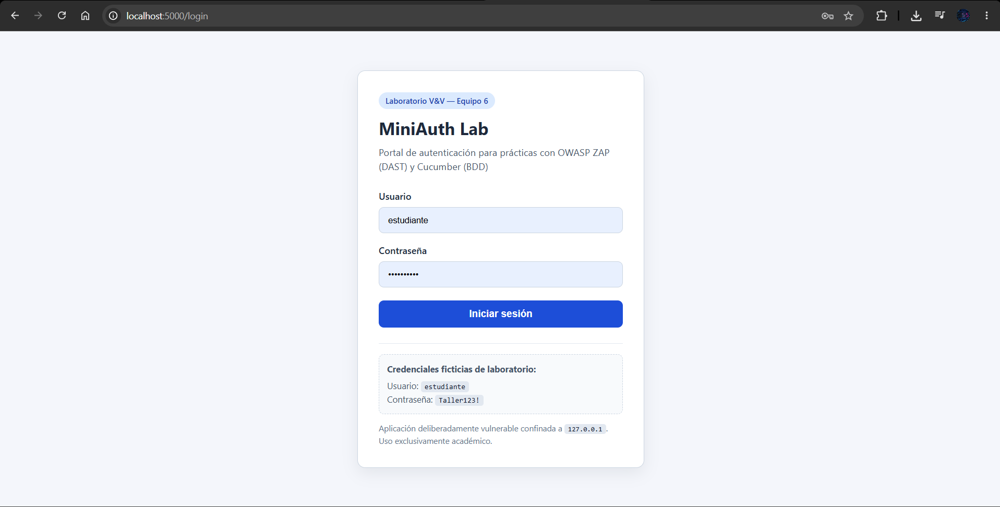
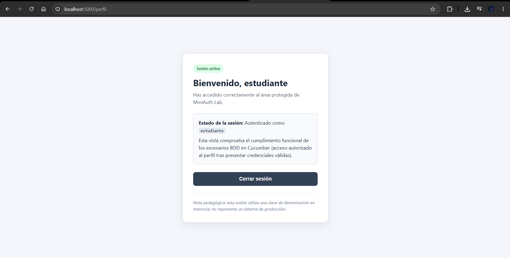
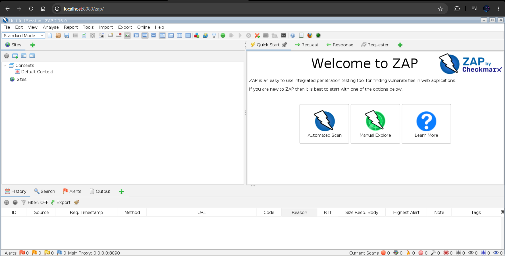
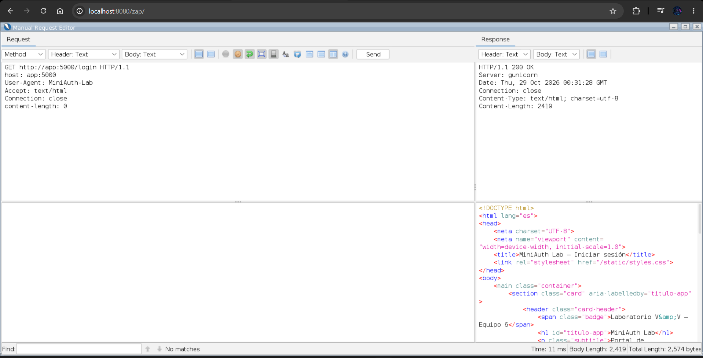
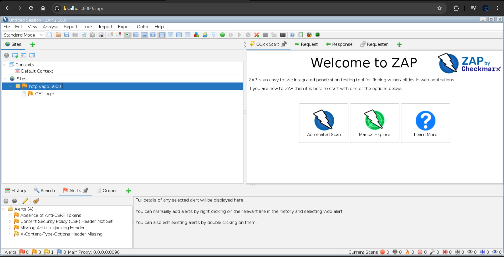
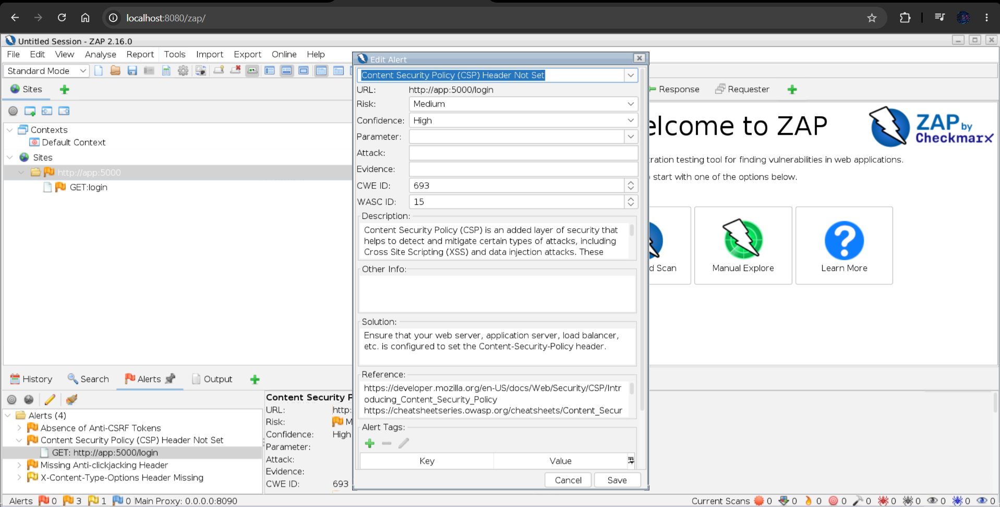
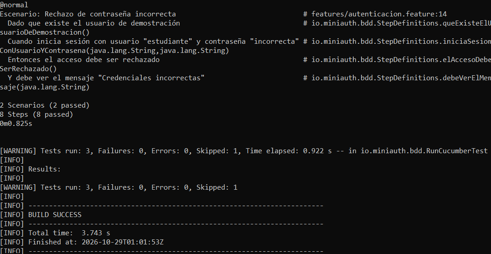
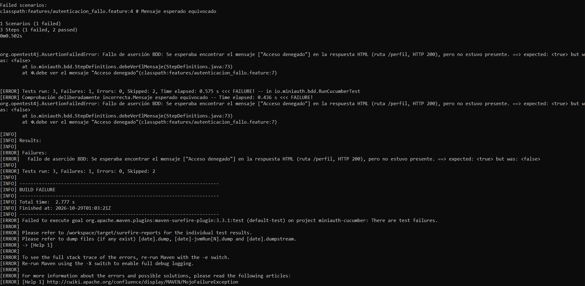
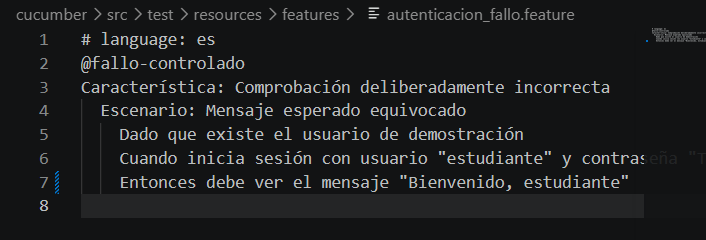
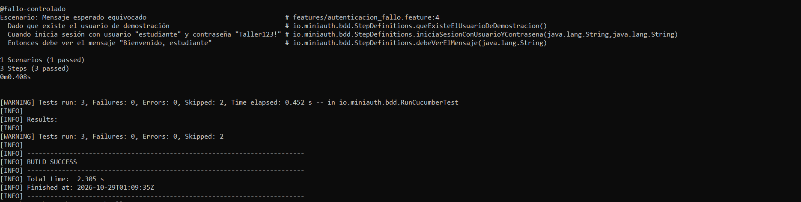

# MiniAuth Lab — Taller práctico de OWASP ZAP (DAST) y Cucumber (BDD)

**Verificación y Validación de Software · Equipo 6**  
**Duración del ejercicio en clase:** 15 a 20 minutos (con la preparación previa completada).  
**Entregables:** **ninguno**. No necesitas guardar capturas ni redactar reportes.

---

## Índice

1. [Qué aprenderás](#1-qué-aprenderás)
2. [Seguridad y requisitos](#2-seguridad-y-requisitos)
3. [Preparación obligatoria ANTES del taller (Pasos 1 y 2)](#3-preparación-obligatoria-antes-del-taller-pasos-1-y-2)
4. [Cronograma de clase (15–20 minutos)](#4-cronograma-de-clase-1520-minutos)
5. [Iniciar el laboratorio en clase](#5-iniciar-el-laboratorio-en-clase)
6. [Paso 3: Conocer MiniAuth](#6-paso-3-conocer-miniauth)
7. [Paso 4: OWASP ZAP — encontrar dos alertas pasivas](#7-paso-4-owasp-zap--encontrar-dos-alertas-pasivas)
8. [Paso 5: Cucumber — un requisito que falla y luego pasa](#8-paso-5-cucumber--un-requisito-que-falla-y-luego-pasa)
9. [Paso 6: Conclusión y apagado](#9-paso-6-conclusión-y-apagado)
10. [Solución de problemas](#10-solución-de-problemas)

---

## 1. Qué aprenderás

En este taller usarás **la misma aplicación web** de dos maneras complementarias:

- **OWASP ZAP (DAST):** observar respuestas HTTP reales de una aplicación en ejecución para identificar configuraciones de seguridad ausentes sin necesidad de revisar su código fuente.
- **Cucumber (BDD):** ejecutar escenarios escritos en **Gherkin en español** y comprobar si el comportamiento del sistema coincide con el resultado esperado.

No necesitas instalar Python, Java, Maven, OWASP ZAP ni Cucumber en tu computadora: todas las herramientas se ejecutan dentro de contenedores Docker.

---

## 2. Seguridad y requisitos

> [!WARNING]
> **MiniAuth contiene configuraciones de seguridad deliberadamente débiles y es exclusivamente para aprendizaje.** No lo publiques en internet ni lo despliegues en entornos de producción. Analiza únicamente el objetivo local autorizado (`http://app:5000`) desde el contenedor ZAP del laboratorio; nunca escanees sistemas de terceros sin autorización. Todos los puertos expuestos por este proyecto están restringidos a `127.0.0.1`.

**Antes de empezar, tu equipo debe contar con:**

- **Git** y **Docker Desktop / Docker Engine** con **Docker Compose** ya instalados y verificados antes de la sesión.
- Docker Desktop **abierto y con el motor en ejecución** en Windows/macOS, o el servicio `docker` activo en Linux.
- Al menos **4 GB de memoria RAM libre** y aproximadamente **5 GB de espacio en disco**.
- Conexión a internet **durante la preparación previa** para clonar el repositorio y descargar las imágenes (no se requiere internet durante el ejercicio en clase una vez descargadas).

**Enlaces oficiales de instalación (solo como referencia previa si aún no los tienes instalados):**

| Sistema operativo | Git | Docker |
|---|---|---|
| Windows 10/11 | https://git-scm.com/downloads | https://docs.docker.com/desktop/setup/install/windows-install/ (requiere WSL 2 y virtualización habilitados) |
| macOS (Intel o Apple Silicon) | https://git-scm.com/downloads | https://docs.docker.com/desktop/setup/install/mac-install/ |
| Linux | https://git-scm.com/downloads | https://docs.docker.com/engine/install/ y https://docs.docker.com/compose/install/linux/ |

> En Windows, asegúrate de haber habilitado **WSL 2** y **Virtual Machine Platform** antes del día del taller.

---

## 3. Preparación obligatoria ANTES del taller (Pasos 1 y 2)

**Completa esta sección antes de la sesión de clase.** La duración de 15 a 20 minutos del taller parte de tener Git, Docker y las imágenes de los contenedores ya descargadas en tu equipo.

### 3.1 Abrir una terminal

- **Windows:** presiona la tecla `Windows`, escribe `PowerShell` y abre **Windows PowerShell**.
- **macOS:** presiona `Cmd + Espacio`, escribe `Terminal` y pulsa `Enter`.
- **Linux:** abre la aplicación **Terminal** (en la mayoría de entornos `Ctrl + Alt + T`).

Pega y ejecuta en esa terminal todos los comandos indicados a continuación, salvo cuando se indique explícitamente usar el navegador o un editor de texto.

### 3.2 Comprobar que Git y Docker funcionan

Ejecuta estos tres comandos uno por uno:

```bash
git --version
docker compose version
docker info
```

**Resultado esperado:** los dos primeros comandos imprimen su número de versión; `docker info` muestra los datos de **Server: Docker Engine** sin errores de conexión. Si aparece el mensaje *Cannot connect to the Docker daemon*, abre primero **Docker Desktop** y espera unos segundos a que el motor termine de iniciar.

### 3.3 Paso 1: Clonar el repositorio

Ubícate en la carpeta donde desees guardar el proyecto y ejecuta:

```bash
git clone https://github.com/marriott55/miniauth-lab.git
cd miniauth-lab
```

Comprueba que te encuentras dentro de la carpeta del proyecto listando su contenido:

**En Windows (PowerShell):**

```powershell
Get-ChildItem
```

**En macOS y Linux:**

```bash
ls
```

**Resultado esperado:** debes ver en la lista los archivos `README.md`, `compose.yaml`, `compose.dev.yaml` y las carpetas `app`, `cucumber` y `docs`.

### 3.4 Paso 2: Descargar las imágenes de Docker antes de clase

Dentro de la carpeta del proyecto, descarga las imágenes preconstruidas ejecutando:

```bash
docker compose pull
```

**Resultado esperado:** Docker descarga las imágenes de `app`, `zap` y `cucumber` sin errores. Con esto concluye la preparación previa; no es necesario dejar los contenedores encendidos hasta el momento de la clase.

---

## 4. Cronograma de clase (15–20 minutos)

| Etapa | Actividad en clase | Tiempo objetivo |
|---|---|---:|
| **Inicio** | Levantar y verificar contenedores (`docker compose up -d`) | 2 min |
| **Paso 3** | Explorar MiniAuth Lab: probar inicio y cierre de sesión | 2 min |
| **Paso 4** | OWASP ZAP: enviar petición HTTP y analizar dos alertas pasivas | 6 min |
| **Paso 5** | Cucumber: ejecutar escenarios `PASS`, fallo controlado `FAIL`, editar Gherkin y verificar `PASS` | 8 min |
| **Paso 6** | Conclusión comparativa y apagado (`docker compose down`) | 2 min |
| **Total** | **Práctica completa con el entorno preparado** | **20 min** |

---

## 5. Iniciar el laboratorio en clase

1. Abre tu terminal y asegúrate de encontrarte dentro de la carpeta del repositorio (`miniauth-lab`).
2. Levanta los servicios en segundo plano y verifica su estado:

```bash
docker compose up -d
docker compose ps
```

**Resultado esperado:**

- `miniauth-app` aparece con estado **Up (healthy)** y el puerto `127.0.0.1:5000->5000/tcp`.
- `miniauth-zap` aparece con estado **Up** y el puerto `127.0.0.1:8080->8080/tcp`.
- El servicio `cucumber` **no** aparece en ejecución continua porque solo se invoca puntualmente en el Paso 5.

Espera a que `miniauth-app` muestre `(healthy)` antes de continuar al siguiente paso.

---

## 6. Paso 3: Conocer MiniAuth

1. Abre tu navegador web (Chrome, Edge, Firefox o Safari).
2. Escribe en la barra de direcciones exactamente `http://localhost:5000/login` y presiona `Enter`.
3. **Resultado esperado:** se muestra la tarjeta **MiniAuth Lab** con los campos **Usuario** y **Contraseña**, el botón azul **Iniciar sesión** y el recuadro inferior con las credenciales ficticias de laboratorio.


*Figura 1: Vista de `http://localhost:5000/login` en el navegador. Observa el título MiniAuth Lab, los campos Usuario y Contraseña, el botón Iniciar sesión y las credenciales ficticias de demostración.*

4. En el campo **Usuario**, escribe `estudiante`.
5. En el campo **Contraseña**, escribe `Taller123!`.
6. Haz clic en **Iniciar sesión**.
7. **Resultado esperado:** el navegador redirige a `http://localhost:5000/perfil`, muestra la etiqueta verde **Sesión activa** y el encabezado **`Bienvenido, estudiante`**.


*Figura 2: Vista de `http://localhost:5000/perfil` tras autenticarse. Observa la etiqueta Sesión activa, el mensaje Bienvenido, estudiante y el botón Cerrar sesión.*

8. Haz clic en el botón **Cerrar sesión**.
9. **Resultado esperado:** la sesión se invalida y regresas al formulario en `http://localhost:5000/login`.

---

## 7. Paso 4: OWASP ZAP — encontrar dos alertas pasivas

> [!IMPORTANT]
> **Diferencia clave entre `localhost` y `app`:**  
> En el navegador de tu computadora accedes a la aplicación mediante `http://localhost:5000`. Sin embargo, **OWASP ZAP se ejecuta dentro de su propio contenedor Docker** en la red interna `miniauth_net`. Dentro de esa red, `localhost` apunta al propio contenedor de ZAP; para comunicarse con la aplicación web desde ZAP debes usar siempre el nombre del servicio: **`http://app:5000/login`**.

### 7.1 Abrir la interfaz principal de OWASP ZAP y el Manual Request Editor

1. Abre una **nueva pestaña** en tu navegador y entra en:
   ```text
   http://localhost:8080/zap
   ```
2. Espera entre **15 y 40 segundos** mientras Webswing carga la interfaz de escritorio de **OWASP ZAP 2.16.0**.
3. Si al iniciar aparece la ventana **Do you want to persist the ZAP session?**, selecciona la opción **No, I do not want to persist this session at this moment in time** y haz clic en **Start** (si aparece una ventana informativa de complementos, ciérrala).


*Figura 3: Interfaz principal de OWASP ZAP 2.16.0 en `http://localhost:8080/zap/`. Observa la barra de menú superior (File, Edit, View, Analyse, Report, Tools...), el panel izquierdo Sites, el área central Welcome to ZAP (Quick Start) y las pestañas inferiores (History, Search, Alerts, Output).*

4. Localiza la **barra de menú superior** de la ventana de ZAP y haz clic en **`Tools`**.
5. En el menú desplegable, selecciona **`Manual Request Editor...`**.
6. Espera a que se abra la ventana titulada **`Manual Request Editor`**.
7. Verifica que está visible la pestaña o sección **`Request`**.

Observa cómo está organizada la ventana `Manual Request Editor`: en la sección `Request` hay un **editor de texto superior** (donde se escriben la línea de solicitud y las cabeceras HTTP) y un **panel inferior** (cuerpo de la petición) que **no es necesario modificar**.

### 7.2 Modificar la petición HTTP

Al abrirse por primera vez, el editor de texto superior puede mostrar una solicitud de ejemplo similar a:

```http
GET http://www.any_domain_name.org/path HTTP/1.1
host: www.any_domain_name.org
```

No te limites a cambiar solo una parte del texto ni busques un cuadro de dirección separado. Realiza exactamente estos pasos:

1. Haz clic dentro del **editor de texto superior** de la sección `Request`.
2. Presiona `Ctrl + A` (o `Cmd + A` en macOS) para seleccionar todo el contenido de ese panel superior.
3. Bórralo y reemplázalo íntegramente por la siguiente petición HTTP (incluyendo una línea en blanco al final):

```http
GET http://app:5000/login HTTP/1.1
Host: app:5000
User-Agent: MiniAuth-Lab
Accept: text/html
Connection: close

```

4. Comprueba que la **primera línea** diga exactamente `GET http://app:5000/login HTTP/1.1`.
5. Comprueba que la **segunda línea** contenga `Host: app:5000` (o `host: app:5000`).
6. **No modifiques** el panel inferior ni los menús desplegables de opciones avanzadas.

Recuerda que usamos `app:5000` porque `app` es el nombre del servicio de MiniAuth dentro de la red de Docker Compose; escribir `localhost:5000` aquí fallaría porque ZAP intentaría conectarse a sí mismo.

### 7.3 Enviar la petición y verificar la respuesta

1. Localiza el botón **`Send`**, situado en la parte superior del editor de la petición.
2. Haz clic **una sola vez** en **`Send`**.
3. Revisa la sección **`Response`**, situada junto a `Request` (si tu ventana está en vista de pestañas separadas, haz clic en la pestaña `Response`; en vista dividida aparece directamente a la derecha).
4. Comprueba en el panel superior de `Response` que la primera línea comienza con **`HTTP/1.1 200 OK`**.
5. Comprueba en el panel inferior de `Response` que aparece el código HTML de **MiniAuth Lab** (`<!DOCTYPE html>... <title>MiniAuth Lab — Iniciar sesión</title>`).

El estado `HTTP/1.1 200 OK` confirma que el contenedor de ZAP se comunicó correctamente con la aplicación web y recibió la página de inicio de sesión para analizarla de forma pasiva.


*Figura 4: Ventana Manual Request Editor tras pulsar Send. A la izquierda (Request) se observa el panel superior con la petición `GET http://app:5000/login HTTP/1.1`, `host: app:5000` y el botón Send; a la derecha (Response) se observa el panel superior con `HTTP/1.1 200 OK` (`Server: gunicorn`) y el panel inferior con el documento HTML de MiniAuth Lab.*

> **Importante:** No pulses `Attack` ni ejecutes `Automated Scan` o `Active Scan`. Este laboratorio utiliza únicamente **análisis pasivo** sobre el tráfico generado por nuestra petición.

### 7.4 Cerrar el editor y consultar las alertas pasivas

1. Cierra la ventana **`Manual Request Editor`** haciendo clic en el botón **`X`** de su esquina superior derecha para regresar a la interfaz principal de ZAP.
2. En el panel superior izquierdo **`Sites`**, despliega la carpeta `Sites` y comprueba que aparece el nodo **`http://app:5000`** y, dentro de él, **`GET:login`**.
3. En la mitad inferior de la ventana principal, haz clic en la pestaña **`Alerts`** (identificada con el icono de bandera).
4. Espera unos segundos a que concluya el análisis pasivo de la respuesta observada.
5. En la lista de alertas del panel inferior izquierdo, identifica estas **dos alertas objetivo** del laboratorio:

| Alerta en OWASP ZAP | Nivel de riesgo | Qué significa en MiniAuth Lab |
|---|---|---|
| **`Content Security Policy (CSP) Header Not Set`** | **Medium** (bandera naranja) | La respuesta HTTP carece de la cabecera `Content-Security-Policy`, que restringe desde qué orígenes el navegador puede ejecutar scripts o cargar recursos. |
| **`Missing Anti-clickjacking Header`** | **Medium** (bandera naranja) | La respuesta HTTP no incluye `X-Frame-Options` ni la directiva `frame-ancestors` de CSP para impedir que la página sea incrustada dentro de un `<frame>` o `<iframe>` no autorizado. |

> **Nota:** Es normal que en la pestaña `Alerts` aparezcan también otras alertas pasivas adicionales (por ejemplo, `Absence of Anti-CSRF Tokens` o `X-Content-Type-Options Header Missing`, mostrando un total de 4 o más alertas). Para este ejercicio solo necesitas inspeccionar las dos alertas de la tabla anterior.


*Figura 5: Interfaz principal de ZAP tras enviar la petición. En el panel superior izquierdo (Sites) aparece `http://app:5000` con `GET:login`; en el panel inferior izquierdo (Alerts) se listan las alertas detectadas pasivamente, incluyendo `Content Security Policy (CSP) Header Not Set` y `Missing Anti-clickjacking Header`.*

6. Haz clic en la flecha junto a **`Content Security Policy (CSP) Header Not Set`** para desplegar la URL afectada (`GET: http://app:5000/login`) y selecciónala (o haz doble clic sobre ella) para consultar su información completa:
   - **`URL`:** `http://app:5000/login`
   - **`Risk`:** `Medium`
   - **`Confidence`:** `High`
   - **`Description`:** explicación del riesgo de no definir una política CSP.
   - **`Solution`:** recomendación para configurar la cabecera `Content-Security-Policy` en el servidor web.
7. Cierra la ventana emergente de la alerta (si la abriste con doble clic, pulsando `Cancel` o `X`) y repite la consulta seleccionando **`Missing Anti-clickjacking Header`**.


*Figura 6: Inspección detallada de la alerta `Content Security Policy (CSP) Header Not Set` para `GET: http://app:5000/login`. Se observan los campos URL, Risk (`Medium`), Confidence (`High`), CWE ID (`693`), Description y Solution.*

**Interpretación:** estas alertas muestran que el análisis dinámico pasivo (DAST) detecta configuraciones de defensa ausentes al examinar las respuestas HTTP del servidor en ejecución, sin que ello implique por sí mismo que la aplicación haya sido comprometida.

---

## 8. Paso 5: Cucumber — un requisito que falla y luego pasa

En esta sección comprobarás los requisitos funcionales de MiniAuth Lab mediante escenarios BDD escritos en **Gherkin en español**:

- `cucumber/src/test/resources/features/autenticacion.feature`: contiene los dos escenarios funcionales principales (`Inicio de sesión correcto` y `Rechazo de contraseña incorrecta`).
- `cucumber/src/test/resources/features/autenticacion_fallo.feature`: contiene un escenario etiquetado con `@fallo-controlado` que exige deliberadamente un mensaje equivocado.
- `cucumber/src/test/java/io/miniauth/bdd/StepDefinitions.java`: traduce cada paso **`Dado`**, **`Cuando`**, **`Entonces`** e **`Y`** en solicitudes HTTP reales hacia `http://app:5000`.

### 8.1 Ejecutar los dos escenarios normales (`PASS`)

Regresa a tu terminal (dentro de la carpeta `miniauth-lab`) y ejecuta:

```bash
docker compose run --rm cucumber
```

**Resultado esperado en la terminal:**

```text
2 Scenarios (2 passed)
8 Steps (8 passed)
[INFO] BUILD SUCCESS
```


*Figura 7: Salida en terminal al ejecutar la suite normal de Cucumber. Observa `2 Scenarios (2 passed)`, `8 Steps (8 passed)` y `[INFO] BUILD SUCCESS`.*

> **Nota sobre el resumen de Maven Surefire:** verás también la línea `[WARNING] Tests run: 3, Failures: 0, Errors: 0, Skipped: 1`. Esto ocurre porque JUnit/Surefire contabiliza los 3 escenarios existentes en total e indica que 1 fue omitido por el filtro (`@fallo-controlado`). Guíate siempre por el resumen de Cucumber (**`2 Scenarios (2 passed)`**) y por **`BUILD SUCCESS`**.

### 8.2 Ejecutar el escenario de fallo controlado (`FAIL` esperado)

Ahora ejecuta únicamente el escenario etiquetado con `@fallo-controlado`:

```bash
docker compose run --rm -e CUCUMBER_FILTER_TAGS=@fallo-controlado cucumber
```

**Resultado esperado en la terminal:**

```text
1 Scenarios (1 failed)
3 Steps (1 failed, 2 passed)
org.opentest4j.AssertionFailedError: Fallo de aserción BDD: Se esperaba encontrar el mensaje ["Acceso denegado"] en la respuesta HTML (ruta /perfil, HTTP 200), pero no estuvo presente.
[INFO] BUILD FAILURE
```


*Figura 8: Salida en terminal del escenario `@fallo-controlado`. Observa `1 Scenarios (1 failed)`, el mensaje de `AssertionFailedError` indicando que se esperaba `["Acceso denegado"]` en `/perfil` y el estado final `[INFO] BUILD FAILURE`.*

> **¿Por qué este fallo es correcto?** El escenario inicia sesión con credenciales válidas (`estudiante` / `Taller123!`), por lo que la aplicación responde correctamente mostrando `Bienvenido, estudiante` en `/perfil`. Como el escenario exigía ver `"Acceso denegado"`, Cucumber detecta la discrepancia y reporta `BUILD FAILURE` (mientras Surefire contabiliza `Tests run: 3, Failures: 1, Errors: 0, Skipped: 2`).

### 8.3 Modificar el escenario Gherkin en tu equipo

Gracias a que `compose.yaml` monta este archivo `.feature` dentro del contenedor, puedes corregir la expectativa desde tu computadora sin necesidad de reconstruir la imagen Docker:

1. Abre el archivo **`cucumber/src/test/resources/features/autenticacion_fallo.feature`** con un editor de texto en tu sistema (por ejemplo, Visual Studio Code, Bloc de notas en Windows, TextEdit en modo texto plano en macOS, o `nano`/tu editor habitual en Linux).
2. Localiza la última línea (línea 7):

```gherkin
    Entonces debe ver el mensaje "Acceso denegado"
```

3. **Cambia únicamente el texto entre comillas** para que coincida con el mensaje real de bienvenida:

```gherkin
    Entonces debe ver el mensaje "Bienvenido, estudiante"
```

4. **Guarda los cambios** en el archivo (`Ctrl + S` en Windows/Linux o `Cmd + S` en macOS).


*Figura 9: Archivo `cucumber/src/test/resources/features/autenticacion_fallo.feature` modificado en el editor. Observa en la línea 7 el cambio del texto esperado a `"Bienvenido, estudiante"`.*

### 8.4 Ejecutar nuevamente el escenario y comprobar que ahora pasa (`PASS`)

Vuelve a tu terminal y ejecuta exactamente el mismo comando del paso 8.2:

```bash
docker compose run --rm -e CUCUMBER_FILTER_TAGS=@fallo-controlado cucumber
```

**Resultado esperado en la terminal:**

```text
1 Scenarios (1 passed)
3 Steps (3 passed)
[INFO] BUILD SUCCESS
```


*Figura 10: Resultado en terminal tras guardar el cambio en `autenticacion_fallo.feature` y volver a ejecutar el comando. Ahora muestra `Entonces debe ver el mensaje "Bienvenido, estudiante"`, `1 Scenarios (1 passed)`, `3 Steps (3 passed)` y `[INFO] BUILD SUCCESS`.*

### 8.5 Restaurar el archivo original con Git

Para dejar el repositorio limpio y en su estado inicial, restaura el archivo ejecutando:

```bash
git restore cucumber/src/test/resources/features/autenticacion_fallo.feature
```

**Resultado esperado:** el comando termina sin errores y devuelve la línea 7 de `autenticacion_fallo.feature` a `"Acceso denegado"`.

---

## 9. Paso 6: Conclusión y apagado

| Herramienta | Enfoque de V&V | Pregunta que responde | Qué comprobaste en MiniAuth Lab |
|---|---|---|---|
| **OWASP ZAP** | **DAST** (Seguridad dinámica) | *¿Qué configuraciones de seguridad están ausentes en las respuestas HTTP de la aplicación en ejecución?* | Se detectaron de forma pasiva las alertas `Content Security Policy (CSP) Header Not Set` y `Missing Anti-clickjacking Header` en `http://app:5000/login`. |
| **Cucumber** | **BDD** (Comportamiento funcional) | *¿La aplicación cumple el comportamiento funcional descrito en los escenarios Gherkin?* | Los 2 escenarios normales pasaron; la expectativa errónea falló por aserción y pasó al corregir el `.feature`. |

**Conclusión:** una aplicación puede cumplir correctamente sus requisitos funcionales para el usuario final y, al mismo tiempo, carecer de cabeceras de seguridad importantes. Combinar BDD y DAST permite verificar tanto la funcionalidad esperada como la postura de seguridad en ejecución.

Para detener y eliminar los contenedores al finalizar la práctica, ejecuta en tu terminal:

```bash
docker compose down
```

**Resultado esperado:** Docker detiene y elimina los contenedores `miniauth-zap` y `miniauth-app` junto con la red `miniauth_net`, conservando las imágenes descargadas en tu equipo.

---

## 10. Solución de problemas

| Síntoma o mensaje | Causa probable | Solución |
|---|---|---|
| `Cannot connect to the Docker daemon` | Docker Desktop o el servicio `docker` está apagado | Abre **Docker Desktop** (o ejecuta `sudo systemctl start docker` en Linux), espera a que inicie y verifica con `docker info`. |
| `pull access denied` / `manifest unknown` | Las imágenes aún no están publicadas como públicas en GHCR o no se descargaron | Si estás trabajando en modo de desarrollo local sin GHCR, usa los comandos de construcción local indicados en la nota al final de esta sección. |
| `port is already allocated` | El puerto `5000` o `8080` está ocupado por otro proceso o contenedor | Ejecuta `docker compose ps` y `docker compose down`, o cierra la aplicación que use ese puerto (en macOS puede ser *Receptor AirPlay* en el puerto 5000). |
| `miniauth-app` no aparece como `healthy` | El contenedor aún está arrancando o tuvo un error | Espera 10 segundos y ejecuta `docker compose ps`. Si persiste, revisa `docker compose logs --tail=60 app`. |
| `http://localhost:8080/zap` tarda en mostrar la interfaz | Webswing está inicializando el escritorio de ZAP | Espera entre 15 y 40 segundos y recarga la pestaña del navegador; puedes verificar el avance con `docker compose logs --tail=40 zap`. |
| `0 Alerts` en la pestaña `Alerts` de ZAP | Visitaste `localhost:5000` desde el navegador del host en lugar de enviar la petición desde ZAP | Sigue las secciones 7.1 a 7.3: abre **Tools → Manual Request Editor...**, envía `GET http://app:5000/login HTTP/1.1` con `Host: app:5000` y pulsa **Send**. |
| `Connection refused` al pulsar `Send` en ZAP | Escribiste `localhost:5000` dentro del editor de ZAP | Cambia la primera línea a `GET http://app:5000/login HTTP/1.1` y la cabecera a `Host: app:5000`. |
| Cucumber falla indicando que no puede conectar a `/health` | El contenedor `app` no está encendido o aún no está `healthy` | Ejecuta `docker compose up -d app`, verifica con `docker compose ps` que indique `(healthy)` y repite el comando de Cucumber. |
| `UndefinedStepException` al ejecutar Cucumber | Se modificó el texto fuera de las comillas en `autenticacion_fallo.feature` | Ejecuta `git restore cucumber/src/test/resources/features/autenticacion_fallo.feature` y cambia únicamente el texto entre comillas (`"Bienvenido, estudiante"`). |
| Tras editar `autenticacion_fallo.feature` sigue fallando por `Acceso denegado` | No se guardó el archivo antes de ejecutar el comando | Guarda el archivo en tu editor (`Ctrl + S` / `Cmd + S`) y vuelve a ejecutar el comando del apartado 8.4. |
| En Linux aparece `permission denied ... docker.sock` | Tu usuario no tiene permisos para conectarse al socket de Docker | Consulta al instructor antes de modificar grupos del sistema (`docker` requiere permisos administrativos). |

### Nota para los autores y mantenedores (Ejecución en desarrollo local sin GHCR)

Mientras las imágenes preconstruidas no hayan sido publicadas en GitHub Container Registry (GHCR), o cuando se desee compilar los contenedores directamente desde los `Dockerfile` locales, utiliza el archivo adicional `compose.dev.yaml`:

- **Construir y levantar el entorno localmente:**
  ```bash
  docker compose -f compose.yaml -f compose.dev.yaml up -d --build
  ```
- **Ejecutar los escenarios normales de Cucumber:**
  ```bash
  docker compose -f compose.yaml -f compose.dev.yaml run --rm cucumber
  ```
- **Ejecutar el escenario `@fallo-controlado`:**
  ```bash
  docker compose -f compose.yaml -f compose.dev.yaml run --rm -e CUCUMBER_FILTER_TAGS=@fallo-controlado cucumber
  ```
- **Apagar el entorno:**
  ```bash
  docker compose -f compose.yaml -f compose.dev.yaml down
  ```
