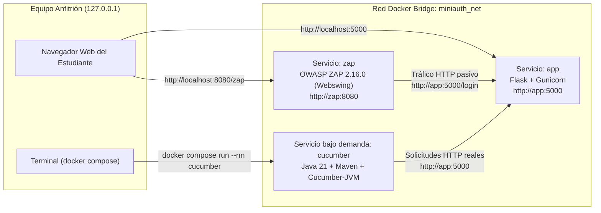

# Arquitectura Técnica — MiniAuth Lab

> **Audiencia:** Docentes, mantenedores del laboratorio y desarrolladores (no es material de lectura obligatoria para los alumnos durante los 20 minutos de práctica).

## 1. Visión General

**MiniAuth Lab** es un entorno autocontenido sobre Docker Compose que integra en una misma práctica dos enfoques complementarios de Verificación y Validación de Software (V&V):

- **DAST (Dynamic Application Security Testing)** con **OWASP ZAP** (vía interfaz Webswing en el navegador): analiza las solicitudes y respuestas HTTP reales de la aplicación en ejecución para detectar configuraciones de seguridad ausentes sin conocer su código fuente.
- **BDD (Behavior-Driven Development)** con **Cucumber-JVM** y **Gherkin en español**: verifica que el comportamiento observable del sistema cumpla los criterios de aceptación funcionales acordados.

---

## 2. Componentes y Servicios Compose

| Servicio | Imagen Base / Etiqueta | Puertos en Host | Red Interna (`miniauth_net`) | Propósito |
|---|---|---|---|---|
| `app` | `ghcr.io/marriott55/miniauth-app:v1.1.0` (`python:3.12.6-slim-bookworm`) | `127.0.0.1:5000:5000` | `http://app:5000` | Aplicación web Flask/Gunicorn con inicio de sesión en memoria y omisión deliberada de cabeceras de seguridad. |
| `zap` | `ghcr.io/zaproxy/zaproxy:2.16.0` | `127.0.0.1:8080:8080` | `http://zap:8080` | Instancia oficial de OWASP ZAP ejecutando `zap-webswing.sh` como usuario `zap`. |
| `cucumber` | `ghcr.io/marriott55/miniauth-cucumber:v1.1.0` (`maven:3.9.9-eclipse-temurin-21`) | Ninguno | Resuelve `http://app:5000` | Ejecutor bajo perfil (`profiles: ["bdd"]`) con dependencias Maven precargadas para pruebas offline (`mvn -o test`). |

---

## 3. Decisiones de Diseño y Seguridad

1. **Confinamiento estricto a `127.0.0.1`:**
   - En Docker Compose, publicar `"5000:5000"` sin dirección IP expone el puerto en `0.0.0.0` (todas las interfaces de red). Por ello, `compose.yaml` enlaza explícitamente `"127.0.0.1:5000:5000"` y `"127.0.0.1:8080:8080"`.
2. **Separación de planos de red (`localhost` vs `app`):**
   - El navegador del estudiante corre en el sistema operativo anfitrión y accede a `http://localhost:5000` y `http://localhost:8080/zap`.
   - Tanto `zap` como `cucumber` corren dentro de sus propios contenedores en la red `miniauth_net`. Para ellos, `localhost` es su propio contenedor; para alcanzar la aplicación web deben dirigirse a `http://app:5000`.
3. **Vulnerabilidades deliberadas pasivas y deterministas:**
   - El hook `@flask_app.after_request` en [`app/app.py`](file:///d:/Users/mapro/Documents/TallerVyVTeam6/app/app.py) garantiza que las respuestas HTML de `/login` no incluyan `Content-Security-Policy` ni `X-Frame-Options`.
   - Esto permite que el analizador pasivo de OWASP ZAP reporte de inmediato y con un 100 % de reproducibilidad:
     - **Content Security Policy (CSP) Header Not Set** (`10038-1`)
     - **Missing Anti-clickjacking Header** (`10020-1`)
   - Se descarta el escaneo activo (Active Scan) para mantener el ejercicio bajo 6 minutos y evitar ruido o bloqueos.
4. **Aislamiento de estado en Cucumber:**
   - [`HttpTestClient.java`](file:///d:/Users/mapro/Documents/TallerVyVTeam6/cucumber/src/test/java/io/miniauth/bdd/HttpTestClient.java) instancia un `CookieManager` nuevo antes de cada escenario (`@Before`), evitando contaminación de sesiones entre escenarios consecutivos.
5. **Fallo controlado y edición en vivo del `.feature` mediante bind mount de solo lectura:**
   - Se incluye [`autenticacion_fallo.feature`](file:///d:/Users/mapro/Documents/TallerVyVTeam6/cucumber/src/test/resources/features/autenticacion_fallo.feature) etiquetado con `@fallo-controlado`, excluido por defecto (`not @fallo-controlado`) e invocable mediante `-e CUCUMBER_FILTER_TAGS=@fallo-controlado`.
   - En [`compose.yaml`](file:///d:/Users/mapro/Documents/TallerVyVTeam6/compose.yaml), el servicio `cucumber` monta `./cucumber/src/test/resources/features/autenticacion_fallo.feature` en `/workspace/src/test/resources/features/autenticacion_fallo.feature` con `type: bind` y `read_only: true`.
   - Para evitar que Maven utilice una copia antigua de `target/test-classes/features/autenticacion_fallo.feature` almacenada al construir la imagen, el `entrypoint` limpia `/workspace/target/test-classes/features` antes de invocar `mvn --batch-mode -o test` (y `maven-resources-plugin` tiene `<overwrite>true</overwrite>`). Así, cada edición o `git restore` realizado por el estudiante en su máquina anfitriona surte efecto inmediato en la siguiente ejecución sin reconstruir la imagen Docker.
